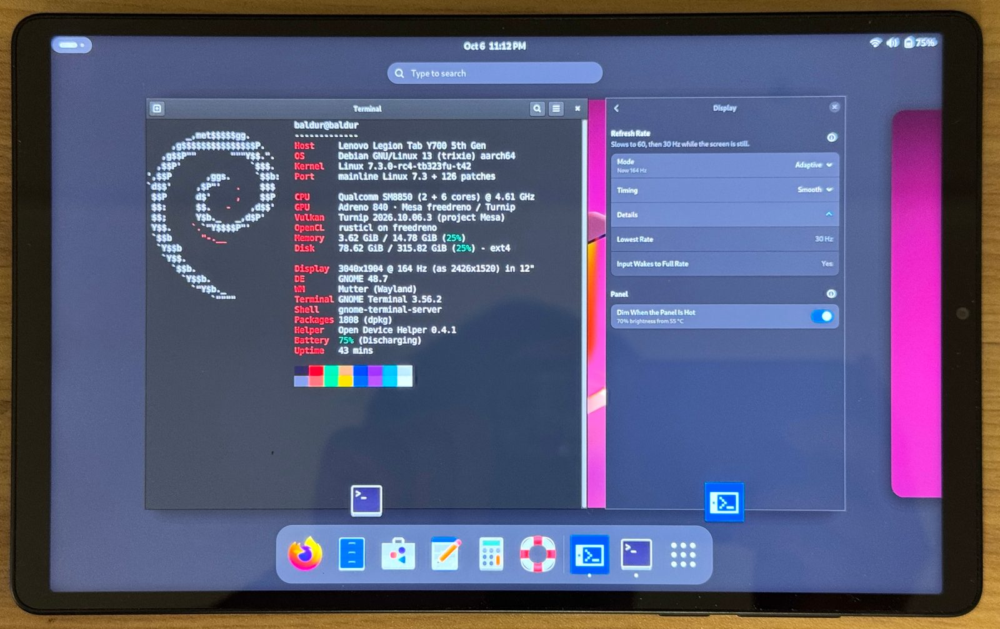

# tb323fu-linux

Mainline Linux on the **Lenovo Legion Tab Gen 5 / Legion Y700 5th Gen** (model **TB323FU**, Snapdragon 8 Elite Gen 5, SM8850 "kaanapali", board "baldur").
The model number is the same in China and elsewhere; the firmware region (PRC / ROW) differs, not the hardware.

**Website: [joonhoekim.github.io/tb323fu-linux](https://joonhoekim.github.io/tb323fu-linux/)** · **[Releases](https://github.com/joonhoekim/tb323fu-linux/releases)**: the kernel and Open Device Helper

> **Status: in daily use, still in development.** What does not work yet: [Known issues](docs/hardware-status.md#known-issues).

> **Android firmware:** tested on ZUI 18.0.12.104; on 18.0.12.187 Linux hangs during boot. Keep the OTA apps
> disabled: [Updating Android firmware](docs/firmware-updates.md).

## What this is

The main product is the **kernel port**: a patch series on a fixed upstream base, the board device tree and the
kernel config. A Debian/GNOME image, services and udev rules are an optional add-on; the kernel assumes no
particular distribution or desktop.

## Where to start

| You want to | Read |
|---|---|
| know what works | [Hardware status](docs/hardware-status.md): a feature counts as working only when it is verified on a tablet |
| see which distributions boot | [Distributions](docs/distros.md): Ubuntu 26.04 LTS, Arch Linux ARM and Fedora through the guided installer, more with their builders |
| root the tablet (install step 1) | **[Rooting](docs/rooting.md)**: back up, then root Android without unlocking (LTBox, KernelSU). If something goes wrong: [Recovery](docs/recovery.md) |
| install Linux after rooting | **[Installing Linux](docs/install.md)**: one guided script ([`tools/install/`](tools/install/README.md)) from your [Windows](docs/install-windows.md), [Linux](docs/install-linux.md) or [macOS](docs/install-macos.md) PC; result: Ubuntu 26.04 LTS with GNOME on the microSD card, or another distribution |
| switch, update or remove Linux | [After installing](docs/after-install.md): Android and back, kernel and helper updates, more systems, going back to stock, symptom index |
| install by hand (other distribution, own kernel, root on internal storage) | [Installing by hand](docs/install-manual.md) |
| change the tablet's settings | [Open Device Helper](docs/helper.md): charging, refresh rate, profiles, LED ring, multiboot, kernel updates |
| make Vulkan and OpenCL faster | [The project's Mesa](docs/after-install.md#optional-the-projects-mesa-for-vulkan-and-opencl) (optional; the default stays the distribution's Mesa) |
| build or review the kernel | [kernel/](kernel/README.md), [PROVENANCE.md](kernel/PROVENANCE.md), [initramfs](kernel/initramfs/README.md) |
| build a root filesystem | [platform files](userspace/platform/README.md), [firmware](firmware/README.md), [`rootfs/`](rootfs/) builders (arm64 host, or x86-64 Linux with qemu-user-binfmt; WSL2 with Ubuntu works, see [install](docs/install-manual.md#prerequisites)) |
| look up a term (`boot_b`, state root, EDL, ...) | [Glossary](docs/glossary.md) |

## Layout

| Path | Contents |
|---|---|
| `kernel/` | patch series, base commit, config, board DT, [`PROVENANCE.md`](kernel/PROVENANCE.md), [`initramfs/`](kernel/initramfs/) (USB way in, boot summary, multiboot root selection) |
| `firmware/` | manifest and a script that extracts the firmware from your own tablet; no firmware files are stored here |
| `rootfs/` | optional root filesystem builders ([docs/distros.md](docs/distros.md)) |
| `userspace/` | `platform/`: files every install needs (udev, systemd units, audio/UCM, sensors) with `install.sh`; `desktop/`: optional extras |
| `helper/` | Open Device Helper: `tb323fu-helperd`, `tb323fu-ctl`, the `tb323fu-settings` app ([docs/helper.md](docs/helper.md)) |
| `packaging/` | Debian, Arch and Nix recipes |
| `android/` | Android-side helpers (switching between Android and Linux) |
| `tools/` | build and flash scripts |
| `docs/` | documentation |

## Contributing

Reports from your own tablet (what works and what does not, with logs) are as useful as code: post them in
[Device reports](https://github.com/joonhoekim/tb323fu-linux/discussions/categories/device-reports). Questions go to
[Q&A](https://github.com/joonhoekim/tb323fu-linux/discussions/categories/q-a), reproducible bugs to
[issues](https://github.com/joonhoekim/tb323fu-linux/issues/new?template=bug-report.yml); pull requests are welcome.
Contributions are taken under the license of the file they change, with a DCO sign-off: see [CONTRIBUTING.md](CONTRIBUTING.md).
Starring the repository helps other TB323FU owners find it.

## License

Every file's SPDX header takes precedence; files without one are covered by [`REUSE.toml`](REUSE.toml), otherwise by the MIT [`LICENSE`](LICENSE).
The repository passes `reuse lint`. [`NOTICE`](NOTICE) has the full map and third-party code; license texts are in [`LICENSES/`](LICENSES/).

| Part | License |
|---|---|
| helper (daemon, CLI, helper core, Open Device Helper app and data files) | `GPL-3.0-or-later` |
| kernel patches and config fragments | `GPL-2.0-only`, as the kernel; imported patches keep their authors and `Signed-off-by` lines |
| board device trees (`kernel/dts/`) | `BSD-3-Clause`, as upstream qcom device trees |
| out-of-tree `aw882xx` driver | `GPL-2.0-only` (AWINIC's headers use the older identifier `GPL-2.0`) |
| GNOME Shell extension | `GPL-2.0-or-later`, as GNOME Shell |
| platform files, root filesystem builders, tools, packaging, site code | `MIT` (a few follow their upstream: UCM2 `BSD-3-Clause`, libcamera tuning `CC0-1.0`, feedbackd rule `LGPL-2.1-or-later`) |
| documentation text | `CC-BY-SA-4.0`; code snippets and commands are also available under `MIT` |

Firmware, Valve's Steam client, the SteamOS-ARM image and distribution base images are not redistributed: the builders download them on your machine.
The project name, icons, update source and signing keys are covered by the [name and trademark policy](TRADEMARKS.md); forks use their own.
This is an independent community project, not affiliated with Lenovo, Qualcomm or Valve; their names only identify the device and software.

## Acknowledgements

Built on the community [kaanapali-mainline](https://github.com/kaanapali-mainline) tree and the work referenced in `kernel/PROVENANCE.md`.
The code and documentation were written with the help of large language models. The author reviewed every change, and a feature is marked as working only when it is verified on a tablet.
